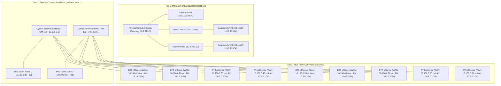

# Proxmox Cyber Defense Exercise (CYDEX) Lab
## Master Systems Inventory, Network Topology & Management Architecture Guide

---

## 1. Executive Summary & Cluster Architecture

The **CYDEX Cyber Range** is an on-premises, multi-tenant cyber defense training and detection engineering platform hosted across a dual-node **Proxmox VE (PVE)** hypervisor cluster. The environment supports red-on-blue cyber simulation exercises with simultaneous operational partitions:

* **Management & Access Plane**: Out-of-band administration, dual Apache Guacamole remote access gateways, central Wazuh SIEM telemetry ingestion, and White Cell simulation control.
* **Red Team Attack Fleet**: 12 Kali Linux attack nodes distributed across Node 1 and Node 2, attached to an isolated exercise transit backbone.
* **Blue Team Defense Enclaves**: 9 military command enclaves (BT1 through BT9), each equipped with an isolated Layer 2 subnet, dedicated virtual pfSense edge router/firewall, Windows Server Active Directory Domain Controller, File Server, and 3 Windows Workstations.

```mermaid
flowchart TD
    subgraph OperatorSubnet ["Operator & Client Access Plane"]
        CLIENT["Analyst / Operator PCs<br>10.2.228.0/24 (e.g. 10.2.228.134)"]
    end

    subgraph PVE_Cluster ["Proxmox VE Cluster (Management Bridge vmbr0: 10.2.229.0/24 - GW: 10.2.229.1)"]
        NODE1["Proxmox node1<br>10.2.229.9:8006"]
        NODE2["Proxmox node2<br>10.2.229.10:8006"]
        
        GUAC1["Guacamole Node 1 (VM 102)<br>10.2.229.60:443"]
        GUAC2["Guacamole Node 2 (VM 108)<br>10.2.229.50:443"]
        
        WHITECELL["White Cell Controller (VM 173)<br>Kali-WhiteCellNode2"]
        WAZUH["Central Wazuh SIEM (VM 198)<br>10.6.0.10 (Dual-Homed)"]
    end

    subgraph Transit_Node1 ["Node 1 Transit Backbone (vmbr1: 10.100.0.0/24)"]
        CORE1["Core pfSense Node 1 (VM 119)<br>LAN: 10.100.0.1 | WAN: 10.2.229.x"]
        RT_N1["Red Team Node 1 Fleet<br>VMs 170, 117, 127, 134<br>IPs: 10.100.0.80 - 10.100.0.83"]
    end

    subgraph Transit_Node2 ["Node 2 Transit Backbone (vmbr1: 10.100.0.0/24)"]
        CORE2["Core pfSense Node 2 (VM 132)<br>LAN: 10.100.0.1 | WAN: 10.2.229.25"]
        RT_N2["Red Team Node 2 Fleet<br>VMs 131, 111, 110, 201, 221-224<br>IPs: 10.100.0.84 - 10.100.0.91"]
    end

    subgraph Enclaves_Node1 ["Node 1 Blue Teams (Subnets: 10.1.0.0/24 - 10.4.0.0/24)"]
        BT1["BT1 (CYCOM)<br>Subnet: 10.1.0.0/24 | pfSense: VM 135<br>DC: 175 | FS: 153 | WS: 151, 152, 168"]
        BT2["BT2 (PA)<br>Subnet: 10.2.0.0/24 | pfSense: VM 202<br>DC: 169 | WS: 139, 140, 176"]
        BT3["BT3 (PN)<br>Subnet: 10.3.0.0/24 | pfSense: VM 203<br>DC: 192 | WS: 141, 142, 128"]
        BT4["BT4 (PAF)<br>Subnet: 10.4.0.0/24 | pfSense: VM 204<br>DC: 136 | WS: 143, 146, 178"]
    end

    subgraph Enclaves_Node2 ["Node 2 Blue Teams (Subnets: 10.5.0.0/24 - 10.9.0.0/24)"]
        BT5["BT5 (PCG)<br>Subnet: 10.5.0.0/24 | pfSense: VM 212<br>DC: 214 | FS: 200/157 | WS: 145, 144, 107"]
        BT6["BT6 (DND)<br>Subnet: 10.6.0.0/24 | pfSense: VM 118<br>DC: 138 | FS: 158 | WS: 147, 148, 184"]
        BT7["BT7 (WESCOM)<br>Subnet: 10.7.0.0/24 | pfSense: VM 124<br>DC: 195 | FS: 159 | WS: 149, 150, 166"]
        BT8["BT8 (NOLCOM)<br>Subnet: 10.8.0.0/24 | pfSense: VM 165<br>DC: 193 | FS: 190 | WS: 186, 187, 183"]
        BT9["BT9 (STRATCOM)<br>Subnet: 10.9.0.0/24 | pfSense: VM 197<br>DC: 194 | FS: 191 | WS: 185, 189, 188"]
    end

    CLIENT -->|HTTPS:443| GUAC1
    CLIENT -->|HTTPS:443| GUAC2
    GUAC1 -.->|Proxy Tunnel :8443| GUAC2

    CORE1 --- Transit_Node1
    CORE2 --- Transit_Node2

    Transit_Node1 --> BT1 & BT2 & BT3 & BT4
    Transit_Node2 --> BT5 & BT6 & BT7 & BT8 & BT9
```



### 1.1 Hypervisor Host Specifications

| Parameter | Proxmox Node 1 (`node1`) | Proxmox Node 2 (`node2`) | Notes / Function |
| :--- | :--- | :--- | :--- |
| **Management FQDN / IP** | `https://10.2.229.9:8006` | `https://10.2.229.10:8006` | PVE WebGUI & SSH cluster management |
| **Installed Memory** | 188 GiB DDR4 | 188 GiB DDR4 | Total host capacity |
| **Active Memory Footprint** | ~149 GiB used (~79%) | ~131 GiB used (~70%) | Host-level memory allocation |
| **KSM Deduplication** | `ksmtuned` enabled (~26.6 GB saved) | `ksmtuned` enabled (~25.8 GB saved) | Zero-page & OS-level memory sharing |
| **Primary Physical Uplink** | `eno1` (bridged to `vmbr0`) | `eno1` (bridged to `vmbr0`) | Connection to physical network switch |
| **Management Bridge (`vmbr0`)** | `10.2.229.0/24` | `10.2.229.0/24` | Hypervisors, Guacamole, DC mgmt interfaces |
| **Lab Transit Bridge (`vmbr1`)** | `10.100.0.0/24` (Node 1 segment) | `10.100.0.0/24` (Node 2 segment) | **Isolated Layer 2 segments** (do not cross) |
| **Hosted Blue Teams** | BT1, BT2, BT3, BT4 | BT5, BT6, BT7, BT8, BT9 | 4 teams on Node 1, 5 teams on Node 2 |
| **Hosted Red Teams** | RedTeam0 – RedTeam3 (VMs 170, 117, 127, 134) | RedTeam4 – RedTeam11 (VMs 131, 111, 110, 201, 221-224) | 4 nodes on Node 1, 8 nodes on Node 2 |

> [!IMPORTANT]
> **CRITICAL ARCHITECTURAL BOUNDARY: Layer 2 Segmentation**
> Even though both `node1` and `node2` configure `vmbr1` with IP subnet `10.100.0.0/24`, these are **isolated Layer 2 broadcast domains**. ARP and broadcast traffic do not cross between nodes on `vmbr1`. Node 1 Red Team VMs (`10.100.0.80 - 10.100.0.83`) cannot ARP-resolve Node 2 VMs (`10.100.0.84 - 10.100.0.91`) directly over `vmbr1`. All inter-node management traffic flows across `vmbr0` (`10.2.229.0/24`).

---

## 2. Master Systems Inventory

### 2.1 Management, Bastion & Security Infrastructure

| Role / System | Node | VMID | Hostname / OS | Management IP (`vmbr0`) | Lab / Transit IP (`vmbr1`) | Open Ports / Protocols | Primary Function |
| :--- | :---: | :---: | :--- | :--- | :--- | :--- | :--- |
| **Proxmox Host 1** | node1 | Host | `node1` (PVE 8.x) | `10.2.229.9` | — | 8006 (WebUI), 22 (SSH) | Hypervisor 1 management |
| **Proxmox Host 2** | node2 | Host | `node2` (PVE 8.x) | `10.2.229.10` | — | 8006 (WebUI), 22 (SSH) | Hypervisor 2 management |
| **Guacamole Bastion 1** | node1 | **102** | `guacamole-node1` (Linux) | `10.2.229.60/24` | `10.100.0.60/24` | 443 (HTTPS), 8443 (Proxy) | Remote access for Node 1 Red/Blue systems |
| **Guacamole Bastion 2** | node2 | **108** | `guacamole-node2` (Linux) | `10.2.229.50/24` | `10.100.0.50/24` | 443 (HTTPS), 8443 (Proxy) | Remote access for Node 2 Red/Blue systems |
| **Core Router Node 1** | node1 | **119** | `CydexCorePfsenseNode1` | `10.2.229.x` (WAN) | `10.100.0.1/24` (LAN) | 443 (WebGUI), 22 (SSH), NAT | Default gateway for Node 1 lab transit |
| **Core Router Node 2** | node2 | **132** | `CydexCorePfsenseN2` | `10.2.229.25/24` (WAN) | `10.100.0.1/24` (LAN) | 443 (WebGUI), 22 (SSH), NAT | Default gateway for Node 2 lab transit |
| **White Cell Controller**| node2 | **173** | `Kali-WhiteCellNode2` | — | `10.100.0.95/24` | 22 (SSH), Custom tools | Range control, injection & scoring |
| **Wazuh SIEM Manager** | node2 | **198** | `BT6-DND-Wazuh` (Linux) | `10.2.229.x` (Optional) | `10.6.0.10/24` (BT6 LAN) | 1514 (Agent), 1515 (Enroll), 443 (Dash), 55000 (API) | Centralized log collection & EDR |

---

### 2.2 Red Team Fleet Inventory

All Red Team machines run Kali Linux (user `kali`), configured with TightVNC on display `:1` (`TCP 5901`), XFCE desktop environment, and standard offensive toolkits (Metasploit, Nmap, Impacket, Responder, Evil-WinRM, CrackMapExec).

| VM Name | Node | VMID | IP Address (`vmbr1`) | MAC Address | VNC Display | Guacamole Instance | Guac Conn ID | Status |
| :--- | :---: | :---: | :--- | :--- | :---: | :--- | :---: | :--- |
| **RedTeam0** | node1 | **170** | `10.100.0.80/24` | `BC:24:11:EF:01:08` | `5901` (`:1`) | Guacamole 102 (node1) | `10` | Online / Active |
| **RedTeam1** | node1 | **117** | `10.100.0.81/24` | `BC:24:11:C6:6A:DE` | `5901` (`:1`) | Guacamole 102 (node1) | `7` | Online / Active |
| **RedTeam2** | node1 | **127** | `10.100.0.82/24` | `BC:24:11:CD:10:83` | `5901` (`:1`) | Guacamole 102 (node1) | `8` | Online / Active |
| **RedTeam3** | node1 | **134** | `10.100.0.83/24` | `BC:24:11:E6:06:F6` | `5901` (`:1`) | Guacamole 102 (node1) | `9` | Online / Active |
| **RedTeam4** | node2 | **131** | `10.100.0.84/24` | `BC:24:11:41:C8:04` | `5901` (`:1`) | Guacamole 108 (node2) | `29` | Online / Active |
| **RedTeam5** | node2 | **111** | `10.100.0.85/24` | `BC:24:11:59:71:56` | `5901` (`:1`) | Guacamole 108 (node2) | `30` | Online / Active |
| **RedTeam6** | node2 | **110** | `10.100.0.86/24` | `BC:24:11:DB:7C:CB` | `5901` (`:1`) | Guacamole 108 (node2) | `11` | Online / Active |
| **RedTeam7** | node2 | **201** | `10.100.0.87/24` | `BC:24:11:ED:72:57` | `5901` (`:1`) | Guacamole 108 (node2) | `31` | Provisioned (2C/4G/32G) |
| **RedTeam8** | node2 | **221** | `10.100.0.88/24` | `BC:24:11:FB:23:E8` | `5901` (`:1`) | Guacamole 108 (node2) | `32` | Online / Active |
| **RedTeam9** | node2 | **222** | `10.100.0.89/24` | `BC:24:11:A9:F8:A6` | `5901` (`:1`) | Guacamole 108 (node2) | `33` | Online / Active |
| **RedTeam10** | node2 | **223** | `10.100.0.90/24` | `BC:24:11:70:96:4B` | `5901` (`:1`) | Guacamole 108 (node2) | `34` | Online / Active |
| **RedTeam11** | node2 | **224** | `10.100.0.91/24` | `BC:24:11:BD:BB:F2` | `5901` (`:1`) | Guacamole 108 (node2) | `35` | Online / Active |

---

### 2.3 Blue Team Enclaves Master Directory (BT1 through BT9)

#### BT1 — Cyber Command (`cycom.local`) | Hosted on `node1`
* **Network Enclave**: Subnet `10.1.0.0/24` | Gateway: `10.1.0.1` | Primary DNS: `10.1.0.2`

| System Role | VMID | Hostname | IPv4 Address | Bridge Interface | Gateway | AD Domain / Status |
| :--- | :---: | :--- | :--- | :--- | :--- | :--- |
| **Edge pfSense** | **135 / 201** | `BT1-CYCOM-PFSENSE` | WAN: `10.100.0.10/24`<br>LAN: `10.1.0.1/24` | `em0` (`vmbr1`)<br>`em1` (`vmbr1`) | `10.100.0.1` (`WANGateWay`) | Gateway & NAT Router |
| **Domain Controller**| **175** | `BT1-CYCOM-DC` | LAN: `10.1.0.2/24`<br>Mgmt: `10.2.229.95/24` | `Ethernet` (`vmbr1`)<br>`Ethernet 2` (`vmbr0`) | `10.1.0.1` | `cycom.local` PDC |
| **File Server** | **153** | `BT1-CYCOM-FileSvr` | `10.1.0.3/24` | `Ethernet` (`vmbr1`) | `10.1.0.1` | Joined `cycom.local` |
| **Workstation 1** | **151** | `BT1-CYCOM-WS1` | `10.1.0.4/24` | `Ethernet` (`vmbr1`) | `10.1.0.1` | Joined `cycom.local` |
| **Workstation 2** | **152** | `BT1-CYCOM-WS2` | `10.1.0.9/24` | `Ethernet` (`vmbr1`) | `10.1.0.1` | Joined `cycom.local` |
| **Workstation 3** | **168** | `BT1-CYCOM-WS3` | `10.1.0.6/24` | `Ethernet` (`vmbr1`) | `10.1.0.1` | Joined `cycom.local` |

---

#### BT2 — Philippine Army (`pa.local`) | Hosted on `node1`
* **Network Enclave**: Subnet `10.2.0.0/24` | Gateway: `10.2.0.1` | Primary DNS: `10.2.0.2`

| System Role | VMID | Hostname | IPv4 Address | Bridge Interface | Gateway | AD Domain / Status |
| :--- | :---: | :--- | :--- | :--- | :--- | :--- |
| **Edge pfSense** | **202** | `BT2-PA-PFSENSE` | WAN: `10.100.0.20/24`<br>LAN: `10.2.0.1/24` | `em0` (`vmbr1`)<br>`em1` (`vmbr1`) | `10.100.0.1` | Gateway & NAT Router |
| **Domain Controller**| **169** | `BT2-PA-DC` | `10.2.0.2/24` | `Ethernet` (`vmbr1`) | `10.2.0.1` | `pa.local` PDC |
| **Workstation 1** | **139** | `BT2-PA-WS1` | `10.2.0.4/24` | `Ethernet` (`vmbr1`) | `10.2.0.1` | Joined `pa.local` |
| **Workstation 2** | **140** | `BT2-PA-WS2` | `10.2.0.5/24` | `Ethernet` (`vmbr1`) | `10.2.0.1` | Joined `pa.local` |
| **Workstation 3** | **176** | `BT2-PA-WS3` | `10.2.0.6/24` | `Ethernet` (`vmbr1`) | `10.2.0.1` | Joined `pa.local` |

---

#### BT3 — Philippine Navy (`pn.local`) | Hosted on `node1`
* **Network Enclave**: Subnet `10.3.0.0/24` | Gateway: `10.3.0.1` | Primary DNS: `10.3.0.2`

| System Role | VMID | Hostname | IPv4 Address | Bridge Interface | Gateway | AD Domain / Status |
| :--- | :---: | :--- | :--- | :--- | :--- | :--- |
| **Edge pfSense** | **203** | `BT3-PN-PFSENSE` | WAN: `10.100.0.30/24`<br>LAN: `10.3.0.1/24` | `em0` (`vmbr1`)<br>`em1` (`vmbr1`) | `10.100.0.1` | Gateway & NAT Router |
| **Domain Controller**| **192** | `BT3-PN-DC` | `10.3.0.2/24` | `Ethernet` (`vmbr1`) | `10.3.0.1` | `pn.local` PDC |
| **Workstation 1** | **141** | `BT3-PN-WS1` | `10.3.0.4/24` | `Ethernet` (`vmbr1`) | `10.3.0.1` | Joined `pn.local` |
| **Workstation 2** | **142** | `BT3-PN-WS2` | `10.3.0.5/24` | `Ethernet` (`vmbr1`) | `10.3.0.1` | Joined `pn.local` |
| **Workstation 3** | **128** | `BT3-PN-WS3` | `10.3.0.6/24` | `Ethernet` (`vmbr1`) | `10.3.0.1` | Joined `pn.local` |

---

#### BT4 — Philippine Air Force (`paf.local`) | Hosted on `node1`
* **Network Enclave**: Subnet `10.4.0.0/24` | Gateway: `10.4.0.1` | Primary DNS: `10.4.0.2`

| System Role | VMID | Hostname | IPv4 Address | Bridge Interface | Gateway | AD Domain / Status |
| :--- | :---: | :--- | :--- | :--- | :--- | :--- |
| **Edge pfSense** | **204** | `BT4-PAF-PFSENSE` | WAN: `10.100.0.40/24`<br>LAN: `10.4.0.1/24` | `em0` (`vmbr1`)<br>`em1` (`vmbr1`) | `10.100.0.1` | Gateway & NAT Router |
| **Domain Controller**| **136** | `BT4-PAF-DC` | `10.4.0.2/24` | `Ethernet` (`vmbr1`) | `10.4.0.1` | `paf.local` PDC |
| **Workstation 1** | **143** | `BT4-PAF-WS1` | `10.4.0.4/24` | `Ethernet` (`vmbr1`) | `10.4.0.1` | Joined `paf.local` |
| **Workstation 2** | **146** | `BT4-PAF-WS2` | `10.4.0.5/24` | `Ethernet` (`vmbr1`) | `10.4.0.1` | Joined `paf.local` |
| **Workstation 3** | **178** | `BT4-PAF-WS3` | `10.4.0.6/24` | `Ethernet` (`vmbr1`) | `10.4.0.1` | Joined `paf.local` |

---

#### BT5 — Philippine Coast Guard (`pcg.local`) | Hosted on `node2`
* **Network Enclave**: Subnet `10.5.0.0/24` | Gateway: `10.5.0.1` | Primary DNS: `10.5.0.2`

| System Role | VMID | Hostname | IPv4 Address | Bridge Interface | Gateway | AD Domain / Status |
| :--- | :---: | :--- | :--- | :--- | :--- | :--- |
| **Edge pfSense** | **212** | `BT5-PCG-PFSENSE` | WAN: `10.100.0.50/24`<br>LAN: `10.5.0.1/24` | `em0` (`vmbr1`)<br>`em1` (`vmbr1`) | `10.100.0.1` | Gateway & NAT Router |
| **Domain Controller**| **214** | `BT5-PCG-DC` | `10.5.0.2/24` | `Ethernet` (`vmbr1`) | `10.5.0.1` | `pcg.local` PDC |
| **File Server** | **200 / 157**| `BT5-PCG-FileSvr` | `10.5.0.3/24` | `Ethernet` (`vmbr1`) | `10.5.0.1` | Joined `pcg.local` |
| **Workstation 1** | **145** | `BT5-PCG-WS1` | `10.5.0.4/24` | `Ethernet` (`vmbr1`) | `10.5.0.1` | Joined `pcg.local` |
| **Workstation 2** | **144** | `BT5-PCG-WS2` | `10.5.0.5/24` | `Ethernet` (`vmbr1`) | `10.5.0.1` | Joined `pcg.local` |
| **Workstation 3** | **107** | `BT5-PCG-WS3` | `10.5.0.6/24` | `Ethernet` (`vmbr1`) | `10.5.0.1` | Joined `pcg.local` |

---

#### BT6 — Department of National Defense (`dnd.local`) | Hosted on `node2`
* **Network Enclave**: Subnet `10.6.0.0/24` | Gateway: `10.6.0.1` | Primary DNS: `10.6.0.2`

| System Role | VMID | Hostname | IPv4 Address | Bridge Interface | Gateway | AD Domain / Status |
| :--- | :---: | :--- | :--- | :--- | :--- | :--- |
| **Edge pfSense** | **118** | `BT6-DND-PFSENSE` | WAN: `10.100.0.60/24`<br>LAN: `10.6.0.1/24` | `em0` (`vmbr1`)<br>`em1` (`vmbr1`) | `10.100.0.1` | Gateway & NAT Router |
| **Domain Controller**| **138** | `BT6-DND-DC` | LAN: `10.6.0.2/24`<br>Mgmt: `10.2.229.78/24` | `Ethernet` (`vmbr1`)<br>`Ethernet 2` (`vmbr0`) | `10.6.0.1` | `dnd.local` PDC |
| **File Server** | **158** | `BT6-DND-FileSvr` | `10.6.0.3/24` | `Ethernet` (`vmbr1`) | `10.6.0.1` | Joined `dnd.local` |
| **Workstation 1** | **147** | `BT6-DND-WS1` | `10.6.0.4/24` | `Ethernet` (`vmbr1`) | `10.6.0.1` | Joined `dnd.local` |
| **Workstation 2** | **148** | `BT6-DND-WS2` | `10.6.0.5/24` | `Ethernet` (`vmbr1`) | `10.6.0.1` | Joined `dnd.local` |
| **Workstation 3** | **184** | `BT6-DND-WS3` | `10.6.0.6/24` | `Ethernet` (`vmbr1`) | `10.6.0.1` | Joined `dnd.local` |
| **Wazuh SIEM Node** | **198** | `BT6-DND-Wazuh` | `10.6.0.10/24` | `ens18` (`vmbr1`) | `10.6.0.1` | Centralized Telemetry Node |

---

#### BT7 — Western Command (`wescom.local`) | Hosted on `node2`
* **Network Enclave**: Subnet `10.7.0.0/24` | Gateway: `10.7.0.1` | Primary DNS: `10.7.0.2`

| System Role | VMID | Hostname | IPv4 Address | Bridge Interface | Gateway | AD Domain / Status |
| :--- | :---: | :--- | :--- | :--- | :--- | :--- |
| **Edge pfSense** | **124** | `BT7-WESCOM-PFSENSE`| WAN: `10.100.0.70/24`<br>LAN: `10.7.0.1/24` | `em0` (`vmbr1`)<br>`em1` (`vmbr1`) | `10.100.0.1` | Gateway & NAT Router |
| **Domain Controller**| **195** | `BT7-WESCOM-DC` | `10.7.0.2/24` | `Ethernet` (`vmbr1`) | `10.7.0.1` | `wescom.local` PDC |
| **File Server** | **159** | `BT7-WESCOM-FileSvr`| `10.7.0.3/24` | `Ethernet` (`vmbr1`) | `10.7.0.1` | Joined `wescom.local` |
| **Workstation 1** | **149** | `BT7-WESCOM-WS1` | `10.7.0.4/24` | `Ethernet` (`vmbr1`) | `10.7.0.1` | Joined `wescom.local` |
| **Workstation 2** | **150** | `BT7-WESCOM-WS2` | `10.7.0.5/24` | `Ethernet` (`vmbr1`) | `10.7.0.1` | Joined `wescom.local` |
| **Workstation 3** | **166** | `BT7-WESCOM-WS3` | `10.7.0.6/24` | `Ethernet` (`vmbr1`) | `10.7.0.1` | Joined `wescom.local` |

---

#### BT8 — Northern Luzon Command (`nolcom.local`) | Hosted on `node2`
* **Network Enclave**: Subnet `10.8.0.0/24` | Gateway: `10.8.0.1` | Primary DNS: `10.8.0.2`

| System Role | VMID | Hostname | IPv4 Address | Bridge Interface | Gateway | AD Domain / Status |
| :--- | :---: | :--- | :--- | :--- | :--- | :--- |
| **Edge pfSense** | **165** | `BT8-NOLCOM-PFSENSE`| WAN: `10.100.0.80/24`<br>LAN: `10.8.0.1/24` | `em0` (`vmbr1`)<br>`em1` (`vmbr1`) | `10.100.0.1` | Gateway & NAT Router |
| **Domain Controller**| **193** | `BT8-NOLCOM-DC` | `10.8.0.2/24` | `Ethernet` (`vmbr1`) | `10.8.0.1` | `nolcom.local` PDC |
| **File Server** | **190** | `BT8-NOLCOM-FileSvr`| `10.8.0.3/24` | `Ethernet` (`vmbr1`) | `10.8.0.1` | Joined `nolcom.local` |
| **Workstation 1** | **186** | `BT8-NOLCOM-WS1` | `10.8.0.4/24` | `Ethernet` (`vmbr1`) | `10.8.0.1` | Joined `nolcom.local` |
| **Workstation 2** | **187** | `BT8-NOLCOM-WS2` | `10.8.0.5/24` | `Ethernet` (`vmbr1`) | `10.8.0.1` | Joined `nolcom.local` |
| **Workstation 3** | **183** | `BT8-NOLCOM-WS3` | `10.8.0.6/24` | `Ethernet` (`vmbr1`) | `10.8.0.1` | Joined `nolcom.local` |

---

#### BT9 — Strategic Command (`stratcom.local`) | Hosted on `node2`
* **Network Enclave**: Subnet `10.9.0.0/24` | Gateway: `10.9.0.1` | Primary DNS: `10.9.0.2`

| System Role | VMID | Hostname | IPv4 Address | Bridge Interface | Gateway | AD Domain / Status |
| :--- | :---: | :--- | :--- | :--- | :--- | :--- |
| **Edge pfSense** | **197** | `BT9-STRATCOM-PFSENSE`| WAN: `10.100.0.90/24`<br>LAN: `10.9.0.1/24` | `em0` (`vmbr1`)<br>`em1` (`vmbr1`) | `10.100.0.1` (`WANGW`) | Gateway & NAT Router |
| **Domain Controller**| **194** | `BT9-STRATCOM-DC` | LAN: `10.9.0.2/24`<br>Mgmt: `10.2.229.96/24` | `Ethernet` (`vmbr1`)<br>`Ethernet 2` (`vmbr0`) | `10.9.0.1` | `stratcom.local` PDC |
| **File Server** | **191** | `BT9-STRATCOM-FileSvr`| `10.9.0.3/24` | `Ethernet` (`vmbr1`) | `10.9.0.1` | Joined `stratcom.local` |
| **Workstation 1** | **185** | `BT9-STRATCOM-WS1` | `10.9.0.4/24` | `Ethernet` (`vmbr1`) | `10.9.0.1` | Joined `stratcom.local` |
| **Workstation 2** | **189** | `BT9-STRATCOM-WS2` | `10.9.0.5/24` | `Ethernet` (`vmbr1`) | `10.9.0.1` | Joined `stratcom.local` |
| **Workstation 3** | **188** | `BT9-STRATCOM-WS3` | `10.9.0.6/24` | `Ethernet` (`vmbr1`) | `10.9.0.1` | Joined `stratcom.local` |

---

## 3. Network Topology & Traffic Routing Architecture

### 3.1 Three-Tier Network Model

The lab relies on a deterministic 3-tier networking topology designed to simulate enterprise segmentation while preserving complete administrative control:



---

### 3.2 Routing Protocols, Default Gateways & Asymmetric Routing Traps

#### Trap 1: Asymmetric Routing on Multi-Homed Bastions (Guacamole)
Both Guacamole VMs (VM 102 on Node 1, VM 108 on Node 2) are dual-homed:
* `ens19`: Management bridge `vmbr0` (`10.2.229.x/24`)
* `ens18`: Lab bridge `vmbr1` (`10.100.0.x/24`)

**Problem**: If Linux assigns the default route to `ens18` via `10.100.0.1`, requests coming from client operators on `10.2.228.0/24` to `10.2.229.50/60` will receive responses routed out through `10.100.0.1` with source IP `10.100.0.x`, breaking TCP handshakes (asymmetric routing drop).

**Fix**: Enforce explicit policy routing in `/etc/netplan/01-netcfg.yaml`:
```yaml
network:
  version: 2
  renderer: networkd
  ethernets:
    ens19:
      addresses:
        - 10.2.229.50/24  # (or 10.2.229.60/24 on node1)
      routes:
        - to: 10.2.228.0/24
          via: 10.2.229.1
          metric: 10
        - to: default
          via: 10.2.229.1
          metric: 100
    ens18:
      addresses:
        - 10.100.0.50/24  # (or 10.100.0.60/24 on node1)
      routes:
        - to: 10.100.0.0/24
          via: 10.100.0.1
          metric: 200
```

---

#### Trap 2: Invalid Upstream Gateway on pfSense LAN Interfaces (`LANGW`)
In pfSense, assigning an upstream gateway on an internal LAN interface causes:
1. A host route `10.100.0.1 -> link#2 (LAN)` sending all internet/transit traffic back into the local switch.
2. pfSense marks the interface as a WAN, breaking Automatic Outbound NAT for `10.x.0.0/24`.

**Standard Rule for all Blue Team pfSense instances**:
* **WAN Interface (`em0`)**: IPv4 Static `10.100.0.x0/24`, Upstream Gateway `10.100.0.1` (`WANGW`), `Block private networks` = **Disabled**.
* **LAN Interface (`em1`)**: IPv4 Static `10.x.0.1/24`, IPv4 Upstream Gateway = **None**.
* **NAT Outbound**: Set to **Automatic** or **Hybrid** with rule translating `10.x.0.0/24` to WAN Address.

---

## 4. Remote Management & Access Control (Apache Guacamole)

Operators access the exercise ranges via web-based HTML5 Remote Desktop (Guacamole) with zero client software required:

### 4.1 Guacamole Gateway Endpoints

| Instance | Node | VMID | URL | Reverse Proxy Port | Dedicated DB Name |
| :--- | :---: | :---: | :--- | :---: | :--- |
| **guacamole-node1** | node1 | **102** | `https://10.2.229.60/guacamole/` | `:443` | `guacamole_db` (MariaDB) |
| **guacamole-node2** | node2 | **108** | `https://10.2.229.50/guacamole/` | `:443` | `guacamole_db` (MariaDB) |
| **Cross-Node Proxy** | node1 | **102** | `https://10.2.229.60:8443/guacamole/`| `:8443` | Proxies directly to VM 108 |

### 4.2 User Roles & Access Boundaries

1. **`guacadmin`**: Superuser administrative account. Manages user provisioning, LDAP mapping, and connection definitions.
2. **`redteam`**: Red Team operator entity. Granted full access to Red Team Kali VMs:
   * Node 1: Connections 7 through 10 (`RedTeam0` to `RedTeam3`).
   * Node 2: Connections 29 through 35 (`RedTeam4` to `RedTeam11`).
3. **`socteam` / `blue_team_users`**: Blue Team defenders restricted to their respective command enclaves (RDP connections into Domain Controllers and Workstations).
4. **`BT6_User` / `BT7_User` / etc.**: Group memberships scoped to specific command subnets.

### 4.3 Red Team VNC Service Configuration

On all Kali Linux VMs, the VNC service runs under `systemd` as user `kali`:

```bash
# Service definition: /etc/systemd/system/vncserver@.service
[Unit]
Description=Start TightVNC server at startup
After=syslog.target network.target

[Service]
Type=forking
User=kali
Group=kali
WorkingDirectory=/home/kali

PIDFile=/home/kali/.vnc/%H:%i.pid
ExecStartPre=-/usr/bin/vncserver -kill :%i > /dev/null 2>&1
ExecStart=/usr/bin/vncserver -depth 24 -geometry 1920x1080 :%i
ExecStop=/usr/bin/vncserver -kill :%i

[Install]
WantedBy=multi-user.target
```

To verify or restart the service from the Proxmox host:
```bash
qm guest exec <VMID> -- systemctl restart vncserver@:1
qm guest exec <VMID> -- ss -tulpn | grep 5901
```

---

## 5. Telemetry & SIEM Architecture (Wazuh)

Host and endpoint telemetry is collected centrally on **`BT6-DND-Wazuh` (VM 198)**:

```mermaid
flowchart LR
    subgraph WindowsEndpoints ["Blue Team Endpoints (Windows Workstations & Servers)"]
        SYSMON["Sysmon (SwiftOnSecurity Config)<br>EID 1, 3, 7, 11, 13"]
        EVTX["Windows Security Audit<br>EID 4688 (CLI), 4624, 4698"]
        POWERSHELL["PowerShell Operational<br>EID 4104 (ScriptBlock)"]
        WINRM["WinRM Operational<br>EID 6, 91"]
        AGENT["Wazuh Agent Service"]
        
        SYSMON --> AGENT
        EVTX --> AGENT
        POWERSHELL --> AGENT
        WINRM --> AGENT
    end

    subgraph WazuhServer ["Wazuh Manager All-in-One (VM 198: 10.6.0.10)"]
        W_PORT["Agent Listener: TCP 1514<br>Enrollment: TCP 1515"]
        W_INDEXER["Wazuh Indexer / OpenSearch"]
        W_DASH["Wazuh Web Dashboard: TCP 443"]
        
        AGENT ==>|Encrypted TLS (ossec.conf)| W_PORT
        W_PORT --> W_INDEXER --> W_DASH
    end
```

### 5.1 Wazuh Agent Configuration Snippet (`ossec.conf`)

Add the following event log collection channels on Windows targets to ensure full detection fidelity:

```xml
<ossec_config>
  <client>
    <server>
      <address>10.6.0.10</address>
      <port>1514</port>
      <protocol>tcp</protocol>
    </server>
  </client>

  <!-- Windows Security Event Log (Process Creation EID 4688) -->
  <localfile>
    <location>Security</location>
    <log_format>eventchannel</log_format>
  </localfile>

  <!-- Microsoft-Windows-Sysmon/Operational -->
  <localfile>
    <location>Microsoft-Windows-Sysmon/Operational</location>
    <log_format>eventchannel</log_format>
  </localfile>

  <!-- PowerShell Script Block Logging (EID 4104) -->
  <localfile>
    <location>Microsoft-Windows-PowerShell/Operational</location>
    <log_format>eventchannel</log_format>
  </localfile>

  <!-- Windows Remote Management (WinRM Operational) -->
  <localfile>
    <location>Microsoft-Windows-WinRM/Operational</location>
    <log_format>eventchannel</log_format>
  </localfile>

  <!-- OpenSSH Operational Log -->
  <localfile>
    <location>OpenSSH/Operational</location>
    <log_format>eventchannel</log_format>
  </localfile>
</ossec_config>
```

---

## 6. Proxmox Hypervisor Operations & Maintenance Runbook

### 6.1 Fast Fleet Health Check Commands (Proxmox CLI)

Execute directly from `node1` or `node2` shell:

```bash
# 1. Check all VM states on the node
qm list

# 2. Check Guest Agent responsiveness across running VMs
for vmid in $(qm list | awk '$3=="running" {print $1}'); do
    echo -n "VM $vmid: "
    qm agent $vmid ping && echo "OK" || echo "AGENT UNRESPONSIVE"
done

# 3. Query IP addresses of all VMs via QEMU Guest Agent
for vmid in $(qm list | awk '$3=="running" {print $1}'); do
    echo "=== VM $vmid IP Addresses ==="
    qm guest exec $vmid -- ip -br a 2>/dev/null || qm guest exec $vmid -- powershell -Command "Get-NetIPAddress -AddressFamily IPv4 | Select-Object IPAddress, InterfaceAlias" 2>/dev/null
done
```

---

### 6.2 Host Memory Optimization (Ballooning & KSM)

Proxmox auto-ballooning skips VMs that do not have a configured `balloon` minimum value. To optimize host memory without inducing guest paging:

```bash
# Set balloon minimum to 75% of assigned memory for high-density Windows/Linux VMs
qm set <VMID> --balloon <MIN_RAM_IN_MB>

# Verify active memory reclamation
qm monitor <VMID>
info balloon
```

---

### 6.3 Exercise Reset & Snapshot Strategy

Before initiating any offensive campaign, create a cluster-wide clean baseline snapshot:

```bash
# Snapshot all exercise VMs with tag RT-BASE-CLEAN
for vmid in 170 117 127 134 135 175 153 151 152 168; do
    echo "Snapshotting VM $vmid..."
    qm snapshot $vmid RT-BASE-CLEAN --description "Pre-exercise clean baseline state" --vmstate 0
done

# Rollback entire enclave after exercise completion (under 60 seconds)
for vmid in 170 117 127 134 135 175 153 151 152 168; do
    echo "Rolling back VM $vmid..."
    qm rollback $vmid RT-BASE-CLEAN
    qm start $vmid
done
```

---

## 7. Systems & Subnets Quick Reference Card

| Command / Unit | Subnet | pfSense WAN / LAN | Domain | DC IP | Workstations | Hosting Node |
| :--- | :--- | :--- | :--- | :--- | :--- | :---: |
| **BT1 (CYCOM)** | `10.1.0.0/24` | `10.100.0.10` / `.1` | `cycom.local` | `10.1.0.2` | `10.1.0.4, .9, .6` | `node1` |
| **BT2 (PA)** | `10.2.0.0/24` | `10.100.0.20` / `.1` | `pa.local` | `10.2.0.2` | `10.2.0.4, .5, .6` | `node1` |
| **BT3 (PN)** | `10.3.0.0/24` | `10.100.0.30` / `.1` | `pn.local` | `10.3.0.2` | `10.3.0.4, .5, .6` | `node1` |
| **BT4 (PAF)** | `10.4.0.0/24` | `10.100.0.40` / `.1` | `paf.local` | `10.4.0.2` | `10.4.0.4, .5, .6` | `node1` |
| **BT5 (PCG)** | `10.5.0.0/24` | `10.100.0.50` / `.1` | `pcg.local` | `10.5.0.2` | `10.5.0.4, .5, .6` | `node2` |
| **BT6 (DND)** | `10.6.0.0/24` | `10.100.0.60` / `.1` | `dnd.local` | `10.6.0.2` | `10.6.0.4, .5, .6` | `node2` |
| **BT7 (WESCOM)**| `10.7.0.0/24` | `10.100.0.70` / `.1` | `wescom.local`| `10.7.0.2` | `10.7.0.4, .5, .6` | `node2` |
| **BT8 (NOLCOM)**| `10.8.0.0/24` | `10.100.0.80` / `.1` | `nolcom.local`| `10.8.0.2` | `10.8.0.4, .5, .6` | `node2` |
| **BT9 (STRATCOM)**| `10.9.0.0/24`| `10.100.0.90` / `.1` | `stratcom.local`| `10.9.0.2` | `10.9.0.4, .5, .6` | `node2` |
| **Red Team (N1)**| `10.100.0.0/24`| Transit (`vmbr1`) | Kali | — | `10.100.0.80 - .83` | `node1` |
| **Red Team (N2)**| `10.100.0.0/24`| Transit (`vmbr1`) | Kali | — | `10.100.0.84 - .91` | `node2` |
| **Management** | `10.2.229.0/24`| Physical Switch | PVE / Guac | — | `10.2.229.9, .10, .50, .60` | Both |
