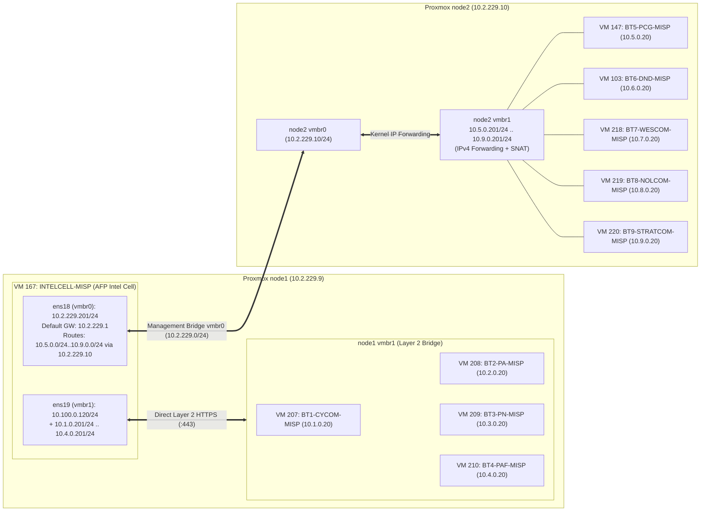

# Step-by-Step Guide: Connecting & Synchronizing VM 167 (`INTELCELL-MISP`) with VMs `BT1`–`BT9` MISP (`node1` & `node2`)

This guide documents the complete network architecture, root cause analysis, step-by-step CLI and Web UI configuration procedures, and live verification results for connecting and synchronizing **VM 167 (`INTELCELL-MISP` on `node1`)** with all nine Blue Team MISP servers across **`node1` (`BT1`–`BT4`)** and **`node2` (`BT5`–`BT9`)**:

- **Proxmox `node1` (`10.2.229.9`)**:
  - **VM 167 (`INTELCELL-MISP`)** — `10.2.229.201` (`AFP Intel Cell`)
  - **VM 207 (`BT1-CYCOM-MISP`)** — `10.1.0.20` (`Cyber Command`)
  - **VM 208 (`BT2-PA-MISP`)** — `10.2.0.20` (`Philippine Army`)
  - **VM 209 (`BT3-PN-MISP`)** — `10.3.0.20` (`Philippine Navy`)
  - **VM 210 (`BT4-PAF-MISP`)** — `10.4.0.20` (`Philippine Air Force`)
- **Proxmox `node2` (`10.2.229.10`)**:
  - **VM 147 (`BT5-PCG-MISP`)** — `10.5.0.20` (`Philippine Coast Guard`)
  - **VM 103 (`BT6-DND-MISP`)** — `10.6.0.20` (`Department of National Defense`)
  - **VM 218 (`BT7-WESCOM-MISP`)** — `10.7.0.20` (`Western Command`)
  - **VM 219 (`BT8-NOLCOM-MISP`)** — `10.8.0.20` (`North Luzon Command`)
  - **VM 220 (`BT9-STRATCOM-MISP`)** — `10.9.0.20` (`Strategic Command`)

---

## 1. Architecture & Complete MISP Inventory (`node1` & `node2`)



### Master Inventory Table (`VM 167` & `BT1`–`BT9` MISP)

| Node | VM ID | VM Name | IPv4 Address | Gateway / Transit | Local Organisation (`host_org_id`) | Organisation UUID | Instance `MISP.uuid` | Sync User Email |
| :---: | :---: | :--- | :--- | :--- | :--- | :--- | :--- | :--- |
| **`node1`** | **167** | `INTELCELL-MISP` | `10.2.229.201/24` (`ens18`)<br>`10.1..4.0.201/24` (`ens19`) | `10.2.229.1` (`ens18`) | `3` (`AFP Intel Cell`) | `bef89191-d8a8-4dfa-91e9-f4b8c6ec9e30` | `29609784-2a66-4010-9b6b-67dff1ba13bb` | `intel@admin.test` |
| **`node1`** | **207** | `BT1-CYCOM-MISP` | `10.1.0.20/24` | `10.1.0.1` | `2` (`Cyber Command`) | `1cee3b3a-8358-4790-b0f5-84f945de2fac` | `3c6f0c5a-dd68-4869-a2d2-d110026fa930` | `cycom@admin.test` |
| **`node1`** | **208** | `BT2-PA-MISP` | `10.2.0.20/24` | `10.2.0.1` | `4` (`Philippine Army`) | `01116853-85fd-43e0-9f46-e3626c14d55b` | `4b8e1d6b-ee79-497a-b3e3-e221137fb041` | `pa@admin.test` |
| **`node1`** | **209** | `BT3-PN-MISP` | `10.3.0.20/24` | `10.3.0.1` | `2` (`Philippine Navy`) | `e9dea1a0-383e-4ed6-972c-cbc5de8a8e14` | `5c9f2e7c-ff8a-4a8b-c4f4-f332248fc152` | `pn@admin.test` |
| **`node1`** | **210** | `BT4-PAF-MISP` | `10.4.0.20/24` | `10.4.0.1` | `2` (`Philippine Air Force`) | `a1bb702a-04d7-4e33-94f6-49e764a19b4d` | `6da03f8d-109b-4b9c-a505-0443359fd263` | `paf@admin.test` |
| **`node2`** | **147** | `BT5-PCG-MISP` | `10.5.0.20/24` | `10.5.0.1` / `.201` | `2` (`Philippine Coast Guard`) | `6e658fb8-4374-4d7d-b76c-cc37953c22be` | `7eb1409e-21ac-4cad-b616-1554460fe374` | `pcg@admin.test` |
| **`node2`** | **103** | `BT6-DND-MISP` | `10.6.0.20/24` | `10.6.0.1` / `.201` | `2` (`Department of National Defense`)| `e18b3108-879d-43cd-9709-d25667f9bd2d` | `8fc251af-32bd-4dbe-b727-2665571ff485` | `dnd@admin.test` |
| **`node2`** | **218** | `BT7-WESCOM-MISP` | `10.7.0.20/24` | `10.7.0.1` / `.201` | `2` (`Western Command`) | `3ea8278a-2619-42d8-bbd0-6581cfac4bdc` | `90d362b0-43ce-4ecf-b838-37766820f596` | `wescom@admin.test` |
| **`node2`** | **219** | `BT8-NOLCOM-MISP` | `10.8.0.20/24` | `10.8.0.1` / `.201` | `2` (`North Luzon Command`) | `ac65f3a2-a402-4456-8c84-1e86868150ad` | `a1e473c1-54df-4fd0-b949-48877931f607` | `nolcom@admin.test` |
| **`node2`** | **220** | `BT9-STRATCOM-MISP`| `10.9.0.20/24` | `10.9.0.1` / `.201` | `2` (`Strategic Command`) | `7fc21469-cb48-4354-bde3-2288048f85b9` | `b2f584d2-65e0-40e1-ba5a-59988a42f718` | `stratcom@admin.test`|

---

## 2. Root Causes Identified

### Cause 1: Network & Routing Segmentation Across `node1` (`BT1`–`BT4`) and `node2` (`BT5`–`BT9`)
1. **On `node1` (`BT1`–`BT4`)**:
   - `/etc/netplan/50-cloud-init.yaml` on **VM 167** defined two conflicting `default` routes (`via 10.2.229.1` on `ens18` and `via 10.100.0.1` on `ens19`) and no routes to `10.1.0.0/24`–`10.4.0.0/24`.
   - Because **VM 167's `ens19`** and **VMs 207–210's `ens18`** share the same Layer 2 bridge **`vmbr1`** on `node1`, adding secondary addresses `10.1.0.201/24`–`10.4.0.201/24` on VM 167's `ens19` (and removing the duplicate default route) establishes direct Layer 2 connectivity without pfSense NAT drops.
2. **Across `node1` ↔ `node2` (`BT5`–`BT9`)**:
   - `vmbr1` on `node1` and `vmbr1` on `node2` are isolated Layer 2 bridges, and Blue Team pfSense routers on `node2` block unsolicited inbound WAN connections.
   - Assigning `10.5.0.201/24`–`10.9.0.201/24` to `vmbr1` on **`node2` (`10.2.229.10`)** with IPv4 forwarding + SNAT and adding static routes `10.5.0.0/24`–`10.9.0.0/24 via 10.2.229.10` on **VM 167** (plus return route `10.2.229.201/32 via 10.<5..9>.0.201` on VMs `147, 103, 218, 219, 220`) provides direct bidirectional routing between **VM 167** and **VMs 147, 103, 218, 219, 220**.

### Cause 2: Cloned MISP Instance UUID Collision (`MISP.uuid`)
- **VM 167** and 8 of the 9 Blue Team MISP VMs (**VMs 208, 209, 210 on `node1`** and **VMs 147, 103, 218, 219, 220 on `node2`**) shared the identical cloned instance UUID `29609784-2a66-4010-9b6b-67dff1ba13bb`. MISP blocks synchronization when `remote_uuid == local_uuid`.

### Cause 3: Misconfigured Sync User `org_id`, `host_org_id`, and `change_pw = 1`
- On **VM 167**, Sync user `intel@admin.test` (`id = 2`) was in `org_id = 1` (`ADMIN`) instead of `org_id = 3` (`AFP Intel Cell`) and had `change_pw = 1`.
- On **VM 208 (`BT2`)** and all five `node2` VMs (**VMs `147, 103, 218, 219, 220`**), the Sync users (`pa@admin.test`, `pcg@admin.test`, `dnd@admin.test`, `wescom@admin.test`, `nolcom@admin.test`, `stratcom@admin.test`) had `change_pw = 1`, which blocks API sync calls.
- On all 10 VMs, `MISP.host_org_id` was set to `1` (`ADMIN`) instead of each VM's local organisation ID.

### Cause 4: Missing Organisations, Sync Server Entries & AuthKeys on `VM 167`
- **VM 167** only had entries for `BT1 CYCOM` and `BT5 PCG` (with wrong `org_id` and misnamed organisation) and was missing **BT2 (`10.2.0.20`)**, **BT3 (`10.3.0.20`)**, **BT4 (`10.4.0.20`)**, **BT6 (`10.6.0.20`)**, **BT7 (`10.7.0.20`)**, **BT8 (`10.8.0.20`)**, and **BT9 (`10.9.0.20`)**.

---

## 3. Step-by-Step Resolution Procedures

### Step 1: Configure Routing on `VM 167` (`INTELCELL-MISP`) and Proxmox `node2` (`10.2.229.10`)

#### 1A. Configure `/etc/netplan/50-cloud-init.yaml` on **VM 167 (`10.2.229.201`)**
```bash
sudo cp /etc/netplan/50-cloud-init.yaml /etc/netplan/50-cloud-init.yaml.bak

sudo tee /etc/netplan/50-cloud-init.yaml > /dev/null << 'EOF'
network:
  version: 2
  ethernets:
    ens18:
      addresses:
      - "10.2.229.201/24"
      routes:
      - to: "default"
        via: "10.2.229.1"
        metric: 100
      - to: "10.5.0.0/24"
        via: "10.2.229.10"
      - to: "10.6.0.0/24"
        via: "10.2.229.10"
      - to: "10.7.0.0/24"
        via: "10.2.229.10"
      - to: "10.8.0.0/24"
        via: "10.2.229.10"
      - to: "10.9.0.0/24"
        via: "10.2.229.10"
      nameservers:
        addresses:
        - 8.8.8.8
        - 1.1.1.1
    ens19:
      addresses:
      - "10.100.0.120/24"
      - "10.1.0.201/24"
      - "10.2.0.201/24"
      - "10.3.0.201/24"
      - "10.4.0.201/24"
EOF

sudo chmod 600 /etc/netplan/*.yaml
sudo netplan apply
```

#### 1B. Configure `vmbr1` Transit Sub-IPs & Forwarding on **Proxmox `node2` (`10.2.229.10`)**
Run on `node2` (or via `ssh root@10.2.229.10` from `node1`):
```bash
sysctl -w net.ipv4.ip_forward=1
echo "net.ipv4.ip_forward=1" > /etc/sysctl.d/99-misp-forward.conf

for t in 5 6 7 8 9; do
  ip addr add 10.${t}.0.201/24 dev vmbr1 2>/dev/null || true
done

iptables -C FORWARD -s 10.2.229.201/32 -j ACCEPT 2>/dev/null || iptables -I FORWARD 1 -s 10.2.229.201/32 -j ACCEPT
iptables -C FORWARD -d 10.2.229.201/32 -j ACCEPT 2>/dev/null || iptables -I FORWARD 1 -d 10.2.229.201/32 -j ACCEPT
iptables -t nat -C POSTROUTING -s 10.2.229.201/32 -o vmbr1 -j MASQUERADE 2>/dev/null || iptables -t nat -A POSTROUTING -s 10.2.229.201/32 -o vmbr1 -j MASQUERADE

mkdir -p /etc/network/interfaces.d
cat << 'EOF' > /etc/network/interfaces.d/misp-transit
iface vmbr1 inet manual
    post-up sysctl -w net.ipv4.ip_forward=1
    post-up ip addr add 10.5.0.201/24 dev vmbr1 || true
    post-up ip addr add 10.6.0.201/24 dev vmbr1 || true
    post-up ip addr add 10.7.0.201/24 dev vmbr1 || true
    post-up ip addr add 10.8.0.201/24 dev vmbr1 || true
    post-up ip addr add 10.9.0.201/24 dev vmbr1 || true
    post-up iptables -C FORWARD -s 10.2.229.201/32 -j ACCEPT 2>/dev/null || iptables -I FORWARD 1 -s 10.2.229.201/32 -j ACCEPT
    post-up iptables -C FORWARD -d 10.2.229.201/32 -j ACCEPT 2>/dev/null || iptables -I FORWARD 1 -d 10.2.229.201/32 -j ACCEPT
    post-up iptables -t nat -C POSTROUTING -s 10.2.229.201/32 -o vmbr1 -j MASQUERADE 2>/dev/null || iptables -t nat -A POSTROUTING -s 10.2.229.201/32 -o vmbr1 -j MASQUERADE
EOF
```

#### 1C. Add Direct Return Route to `10.2.229.201/32` on `node2` VMs (`147, 103, 218, 219, 220`)
On each `node2` MISP VM (`<TEAM>` = `5`..`9`), update `/etc/netplan/50-cloud-init.yaml`:
```bash
sudo tee /etc/netplan/50-cloud-init.yaml > /dev/null << 'EOF'
network:
  version: 2
  ethernets:
    ens18:
      addresses:
      - "10.<TEAM>.0.20/24"
      routes:
      - to: "default"
        via: "10.<TEAM>.0.1"
      - to: "10.2.229.201/32"
        via: "10.<TEAM>.0.201"
EOF
sudo chmod 600 /etc/netplan/*.yaml
sudo netplan apply
```

---

### Step 2: Configure `MISP.uuid`, `host_org_id`, Sync Users & AuthKeys on `BT1`–`BT9` VMs

Run the corresponding block on each Blue Team MISP VM:

```bash
# --- VM 207 (BT1-CYCOM-MISP, 10.1.0.20) ---
sudo docker exec -u www-data misp-docker-misp-core-1 /var/www/MISP/app/Console/cake Admin setSetting "MISP.host_org_id" 2
sudo docker exec misp-docker-db-1 mysql -u misp -pexample misp -e "
UPDATE users SET org_id=2, change_pw=0, termsaccepted=1 WHERE id=2;
UPDATE auth_keys SET allowed_ips=NULL;
UPDATE servers SET org_id=2, remote_org_id=3, push=1, pull=1, self_signed=1 WHERE id=1;
"

# --- VM 208 (BT2-PA-MISP, 10.2.0.20) ---
sudo docker exec -u www-data misp-docker-misp-core-1 /var/www/MISP/app/Console/cake Admin setSetting "MISP.uuid" "4b8e1d6b-ee79-497a-b3e3-e221137fb041"
sudo docker exec -u www-data misp-docker-misp-core-1 /var/www/MISP/app/Console/cake Admin setSetting "MISP.host_org_id" 4
HASH=$(sudo docker exec misp-docker-misp-core-1 php -r 'echo password_hash("BT2PAmispSyncKey2026CyDexRangeNode1VM208", PASSWORD_BCRYPT);')
sudo docker exec misp-docker-db-1 mysql -u misp -pexample misp -e "
UPDATE users SET org_id=4, change_pw=0, termsaccepted=1, authkey='BT2PAmispSyncKey2026CyDexRangeNode1VM208' WHERE id=4;
DELETE FROM auth_keys WHERE comment='VM167 Sync Key';
INSERT INTO auth_keys (uuid, authkey, authkey_start, authkey_end, created, expiration, read_only, user_id, comment, allowed_ips, unique_ips)
VALUES (UUID(), '$HASH', 'BT2P', 'M208', UNIX_TIMESTAMP(), 0, 0, 4, 'VM167 Sync Key', NULL, NULL);
UPDATE auth_keys SET allowed_ips=NULL;
UPDATE servers SET org_id=4, remote_org_id=7, push=1, pull=1, self_signed=1 WHERE id=1;
"

# --- VM 209 (BT3-PN-MISP, 10.3.0.20) ---
sudo docker exec -u www-data misp-docker-misp-core-1 /var/www/MISP/app/Console/cake Admin setSetting "MISP.uuid" "5c9f2e7c-ff8a-4a8b-c4f4-f332248fc152"
sudo docker exec -u www-data misp-docker-misp-core-1 /var/www/MISP/app/Console/cake Admin setSetting "MISP.host_org_id" 2
HASH=$(sudo docker exec misp-docker-misp-core-1 php -r 'echo password_hash("BT3PNmispSyncKey2026CyDexRangeNode1VM209", PASSWORD_BCRYPT);')
sudo docker exec misp-docker-db-1 mysql -u misp -pexample misp -e "
UPDATE users SET org_id=2, change_pw=0, termsaccepted=1, authkey='BT3PNmispSyncKey2026CyDexRangeNode1VM209' WHERE id=2;
DELETE FROM auth_keys WHERE comment='VM167 Sync Key';
INSERT INTO auth_keys (uuid, authkey, authkey_start, authkey_end, created, expiration, read_only, user_id, comment, allowed_ips, unique_ips)
VALUES (UUID(), '$HASH', 'BT3P', 'M209', UNIX_TIMESTAMP(), 0, 0, 2, 'VM167 Sync Key', NULL, NULL);
UPDATE auth_keys SET allowed_ips=NULL;
UPDATE servers SET org_id=2, remote_org_id=3, push=1, pull=1, self_signed=1 WHERE id=1;
"

# --- VM 210 (BT4-PAF-MISP, 10.4.0.20) ---
sudo docker exec -u www-data misp-docker-misp-core-1 /var/www/MISP/app/Console/cake Admin setSetting "MISP.uuid" "6da03f8d-109b-4b9c-a505-0443359fd263"
sudo docker exec -u www-data misp-docker-misp-core-1 /var/www/MISP/app/Console/cake Admin setSetting "MISP.host_org_id" 2
HASH=$(sudo docker exec misp-docker-misp-core-1 php -r 'echo password_hash("BT4PAFmispSyncKey2026CyDexRangeNode1V210", PASSWORD_BCRYPT);')
sudo docker exec misp-docker-db-1 mysql -u misp -pexample misp -e "
UPDATE users SET org_id=2, change_pw=0, termsaccepted=1, authkey='BT4PAFmispSyncKey2026CyDexRangeNode1V210' WHERE id=2;
DELETE FROM auth_keys WHERE comment='VM167 Sync Key';
INSERT INTO auth_keys (uuid, authkey, authkey_start, authkey_end, created, expiration, read_only, user_id, comment, allowed_ips, unique_ips)
VALUES (UUID(), '$HASH', 'BT4P', 'V210', UNIX_TIMESTAMP(), 0, 0, 2, 'VM167 Sync Key', NULL, NULL);
UPDATE auth_keys SET allowed_ips=NULL;
UPDATE servers SET org_id=2, remote_org_id=3, push=1, pull=1, self_signed=1 WHERE id=1;
"

# --- VM 147 (BT5-PCG-MISP, 10.5.0.20) ---
sudo docker exec -u www-data misp-docker-misp-core-1 /var/www/MISP/app/Console/cake Admin setSetting "MISP.uuid" "7eb1409e-21ac-4cad-b616-1554460fe374"
sudo docker exec -u www-data misp-docker-misp-core-1 /var/www/MISP/app/Console/cake Admin setSetting "MISP.host_org_id" 2
sudo docker exec misp-docker-db-1 mysql -u misp -pexample misp -e "
UPDATE users SET org_id=2, change_pw=0, termsaccepted=1 WHERE id=2;
UPDATE auth_keys SET allowed_ips=NULL;
UPDATE servers SET org_id=2, remote_org_id=3, push=1, pull=1, self_signed=1 WHERE id=1;
"

# --- VM 103 (BT6-DND-MISP, 10.6.0.20) ---
sudo docker exec -u www-data misp-docker-misp-core-1 /var/www/MISP/app/Console/cake Admin setSetting "MISP.uuid" "8fc251af-32bd-4dbe-b727-2665571ff485"
sudo docker exec -u www-data misp-docker-misp-core-1 /var/www/MISP/app/Console/cake Admin setSetting "MISP.host_org_id" 2
HASH=$(sudo docker exec misp-docker-misp-core-1 php -r 'echo password_hash("BT6DNDmispSyncKey2026CyDexRangeNode2V103", PASSWORD_BCRYPT);')
sudo docker exec misp-docker-db-1 mysql -u misp -pexample misp -e "
UPDATE users SET org_id=2, change_pw=0, termsaccepted=1, authkey='BT6DNDmispSyncKey2026CyDexRangeNode2V103' WHERE id=2;
DELETE FROM auth_keys WHERE comment='VM167 Sync Key';
INSERT INTO auth_keys (uuid, authkey, authkey_start, authkey_end, created, expiration, read_only, user_id, comment, allowed_ips, unique_ips)
VALUES (UUID(), '$HASH', 'BT6D', 'V103', UNIX_TIMESTAMP(), 0, 0, 2, 'VM167 Sync Key', NULL, NULL);
UPDATE auth_keys SET allowed_ips=NULL;
UPDATE servers SET org_id=2, remote_org_id=3, push=1, pull=1, self_signed=1 WHERE id=1;
"

# --- VM 218 (BT7-WESCOM-MISP, 10.7.0.20) ---
sudo docker exec -u www-data misp-docker-misp-core-1 /var/www/MISP/app/Console/cake Admin setSetting "MISP.uuid" "90d362b0-43ce-4ecf-b838-37766820f596"
sudo docker exec -u www-data misp-docker-misp-core-1 /var/www/MISP/app/Console/cake Admin setSetting "MISP.host_org_id" 2
HASH=$(sudo docker exec misp-docker-misp-core-1 php -r 'echo password_hash("BT7WESmispSyncKey2026CyDexRangeNode2V218", PASSWORD_BCRYPT);')
sudo docker exec misp-docker-db-1 mysql -u misp -pexample misp -e "
UPDATE users SET org_id=2, change_pw=0, termsaccepted=1, authkey='BT7WESmispSyncKey2026CyDexRangeNode2V218' WHERE id=2;
DELETE FROM auth_keys WHERE comment='VM167 Sync Key';
INSERT INTO auth_keys (uuid, authkey, authkey_start, authkey_end, created, expiration, read_only, user_id, comment, allowed_ips, unique_ips)
VALUES (UUID(), '$HASH', 'BT7W', 'V218', UNIX_TIMESTAMP(), 0, 0, 2, 'VM167 Sync Key', NULL, NULL);
UPDATE auth_keys SET allowed_ips=NULL;
UPDATE servers SET org_id=2, remote_org_id=3, push=1, pull=1, self_signed=1 WHERE id=1;
"

# --- VM 219 (BT8-NOLCOM-MISP, 10.8.0.20) ---
sudo docker exec -u www-data misp-docker-misp-core-1 /var/www/MISP/app/Console/cake Admin setSetting "MISP.uuid" "a1e473c1-54df-4fd0-b949-48877931f607"
sudo docker exec -u www-data misp-docker-misp-core-1 /var/www/MISP/app/Console/cake Admin setSetting "MISP.host_org_id" 2
HASH=$(sudo docker exec misp-docker-misp-core-1 php -r 'echo password_hash("BT8NOLmispSyncKey2026CyDexRangeNode2V219", PASSWORD_BCRYPT);')
sudo docker exec misp-docker-db-1 mysql -u misp -pexample misp -e "
UPDATE users SET org_id=2, change_pw=0, termsaccepted=1, authkey='BT8NOLmispSyncKey2026CyDexRangeNode2V219' WHERE id=2;
DELETE FROM auth_keys WHERE comment='VM167 Sync Key';
INSERT INTO auth_keys (uuid, authkey, authkey_start, authkey_end, created, expiration, read_only, user_id, comment, allowed_ips, unique_ips)
VALUES (UUID(), '$HASH', 'BT8N', 'V219', UNIX_TIMESTAMP(), 0, 0, 2, 'VM167 Sync Key', NULL, NULL);
UPDATE auth_keys SET allowed_ips=NULL;
UPDATE servers SET org_id=2, remote_org_id=3, push=1, pull=1, self_signed=1 WHERE id=1;
"

# --- VM 220 (BT9-STRATCOM-MISP, 10.9.0.20) ---
sudo docker exec -u www-data misp-docker-misp-core-1 /var/www/MISP/app/Console/cake Admin setSetting "MISP.uuid" "b2f584d2-65e0-40e1-ba5a-59988a42f718"
sudo docker exec -u www-data misp-docker-misp-core-1 /var/www/MISP/app/Console/cake Admin setSetting "MISP.host_org_id" 2
HASH=$(sudo docker exec misp-docker-misp-core-1 php -r 'echo password_hash("BT9STRmispSyncKey2026CyDexRangeNode2V220", PASSWORD_BCRYPT);')
sudo docker exec misp-docker-db-1 mysql -u misp -pexample misp -e "
UPDATE users SET org_id=2, change_pw=0, termsaccepted=1, authkey='BT9STRmispSyncKey2026CyDexRangeNode2V220' WHERE id=2;
DELETE FROM auth_keys WHERE comment='VM167 Sync Key';
INSERT INTO auth_keys (uuid, authkey, authkey_start, authkey_end, created, expiration, read_only, user_id, comment, allowed_ips, unique_ips)
VALUES (UUID(), '$HASH', 'BT9S', 'V220', UNIX_TIMESTAMP(), 0, 0, 2, 'VM167 Sync Key', NULL, NULL);
UPDATE auth_keys SET allowed_ips=NULL;
UPDATE servers SET org_id=2, remote_org_id=3, push=1, pull=1, self_signed=1 WHERE id=1;
"
```

---

### Step 3: Register All 9 Blue Team Organisations & Sync Servers on `VM 167` (`INTELCELL-MISP`)

Run on **VM 167 (`10.2.229.201`)**:
```bash
sudo docker exec -u www-data misp-docker-misp-core-1 /var/www/MISP/app/Console/cake Admin setSetting "MISP.host_org_id" 3

sudo docker exec misp-docker-db-1 mysql -u misp -pexample misp -e "
UPDATE users SET org_id=3, change_pw=0, termsaccepted=1 WHERE id=2;
UPDATE auth_keys SET allowed_ips=NULL;

UPDATE organisations SET name='Cyber Command', local=0 WHERE uuid='1cee3b3a-8358-4790-b0f5-84f945de2fac';
UPDATE organisations SET name='Philippine Coast Guard', local=0 WHERE uuid='6e658fb8-4374-4d7d-b76c-cc37953c22be';

INSERT INTO organisations (name, date_created, date_modified, description, type, nationality, sector, created_by, uuid, local)
SELECT 'Philippine Army', NOW(), NOW(), 'BT2 PA', 'Military', 'PH', 'Defense', 1, '01116853-85fd-43e0-9f46-e3626c14d55b', 0
WHERE NOT EXISTS (SELECT 1 FROM organisations WHERE uuid='01116853-85fd-43e0-9f46-e3626c14d55b');

INSERT INTO organisations (name, date_created, date_modified, description, type, nationality, sector, created_by, uuid, local)
SELECT 'Philippine Navy', NOW(), NOW(), 'BT3 PN', 'Military', 'PH', 'Defense', 1, 'e9dea1a0-383e-4ed6-972c-cbc5de8a8e14', 0
WHERE NOT EXISTS (SELECT 1 FROM organisations WHERE uuid='e9dea1a0-383e-4ed6-972c-cbc5de8a8e14');

INSERT INTO organisations (name, date_created, date_modified, description, type, nationality, sector, created_by, uuid, local)
SELECT 'Philippine Air Force', NOW(), NOW(), 'BT4 PAF', 'Military', 'PH', 'Defense', 1, 'a1bb702a-04d7-4e33-94f6-49e764a19b4d', 0
WHERE NOT EXISTS (SELECT 1 FROM organisations WHERE uuid='a1bb702a-04d7-4e33-94f6-49e764a19b4d');

INSERT INTO organisations (name, date_created, date_modified, description, type, nationality, sector, created_by, uuid, local)
SELECT 'Department of National Defense', NOW(), NOW(), 'BT6 DND', 'Military', 'PH', 'Defense', 1, 'e18b3108-879d-43cd-9709-d25667f9bd2d', 0
WHERE NOT EXISTS (SELECT 1 FROM organisations WHERE uuid='e18b3108-879d-43cd-9709-d25667f9bd2d');

INSERT INTO organisations (name, date_created, date_modified, description, type, nationality, sector, created_by, uuid, local)
SELECT 'Western Command', NOW(), NOW(), 'BT7 WESCOM', 'Military', 'PH', 'Defense', 1, '3ea8278a-2619-42d8-bbd0-6581cfac4bdc', 0
WHERE NOT EXISTS (SELECT 1 FROM organisations WHERE uuid='3ea8278a-2619-42d8-bbd0-6581cfac4bdc');

INSERT INTO organisations (name, date_created, date_modified, description, type, nationality, sector, created_by, uuid, local)
SELECT 'North Luzon Command', NOW(), NOW(), 'BT8 NOLCOM', 'Military', 'PH', 'Defense', 1, 'ac65f3a2-a402-4456-8c84-1e86868150ad', 0
WHERE NOT EXISTS (SELECT 1 FROM organisations WHERE uuid='ac65f3a2-a402-4456-8c84-1e86868150ad');

INSERT INTO organisations (name, date_created, date_modified, description, type, nationality, sector, created_by, uuid, local)
SELECT 'Strategic Command', NOW(), NOW(), 'BT9 STRATCOM', 'Military', 'PH', 'Defense', 1, '7fc21469-cb48-4354-bde3-2288048f85b9', 0
WHERE NOT EXISTS (SELECT 1 FROM organisations WHERE uuid='7fc21469-cb48-4354-bde3-2288048f85b9');

SET @org_bt1 = (SELECT id FROM organisations WHERE uuid='1cee3b3a-8358-4790-b0f5-84f945de2fac' LIMIT 1);
SET @org_bt2 = (SELECT id FROM organisations WHERE uuid='01116853-85fd-43e0-9f46-e3626c14d55b' LIMIT 1);
SET @org_bt3 = (SELECT id FROM organisations WHERE uuid='e9dea1a0-383e-4ed6-972c-cbc5de8a8e14' LIMIT 1);
SET @org_bt4 = (SELECT id FROM organisations WHERE uuid='a1bb702a-04d7-4e33-94f6-49e764a19b4d' LIMIT 1);
SET @org_bt5 = (SELECT id FROM organisations WHERE uuid='6e658fb8-4374-4d7d-b76c-cc37953c22be' LIMIT 1);
SET @org_bt6 = (SELECT id FROM organisations WHERE uuid='e18b3108-879d-43cd-9709-d25667f9bd2d' LIMIT 1);
SET @org_bt7 = (SELECT id FROM organisations WHERE uuid='3ea8278a-2619-42d8-bbd0-6581cfac4bdc' LIMIT 1);
SET @org_bt8 = (SELECT id FROM organisations WHERE uuid='ac65f3a2-a402-4456-8c84-1e86868150ad' LIMIT 1);
SET @org_bt9 = (SELECT id FROM organisations WHERE uuid='7fc21469-cb48-4354-bde3-2288048f85b9' LIMIT 1);

UPDATE servers SET name='BT5 PCG', url='https://10.5.0.20', authkey='BhfpSUZAHgtXhYtL5XYCHgkkTrJqszitapIx2tCn', org_id=3, remote_org_id=@org_bt5, push=1, pull=1, self_signed=1 WHERE id=1;
UPDATE servers SET name='BT1 CYCOM', url='https://10.1.0.20', authkey='KK9b7INc02ZZv4K4b8as53GrFGeWbJtnKbrifssR', org_id=3, remote_org_id=@org_bt1, push=1, pull=1, self_signed=1 WHERE id=2;

DELETE FROM servers WHERE url IN ('https://10.2.0.20', 'https://10.3.0.20', 'https://10.4.0.20', 'https://10.6.0.20', 'https://10.7.0.20', 'https://10.8.0.20', 'https://10.9.0.20');

INSERT INTO servers (name, url, authkey, org_id, push, pull, lastpulledid, lastpushedid, organization, remote_org_id, publish_without_email, unpublish_event, self_signed, pull_rules, push_rules, cert_file, client_cert_file, internal, skip_proxy, caching_enabled, priority)
VALUES
('BT2 PA', 'https://10.2.0.20', 'BT2PAmispSyncKey2026CyDexRangeNode1VM208', 3, 1, 1, 0, 0, '', @org_bt2, 0, 0, 1, '', '', NULL, NULL, 0, 0, 0, 0),
('BT3 PN', 'https://10.3.0.20', 'BT3PNmispSyncKey2026CyDexRangeNode1VM209', 3, 1, 1, 0, 0, '', @org_bt3, 0, 0, 1, '', '', NULL, NULL, 0, 0, 0, 0),
('BT4 PAF', 'https://10.4.0.20', 'BT4PAFmispSyncKey2026CyDexRangeNode1V210', 3, 1, 1, 0, 0, '', @org_bt4, 0, 0, 1, '', '', NULL, NULL, 0, 0, 0, 0),
('BT6 DND', 'https://10.6.0.20', 'BT6DNDmispSyncKey2026CyDexRangeNode2V103', 3, 1, 1, 0, 0, '', @org_bt6, 0, 0, 1, '', '', NULL, NULL, 0, 0, 0, 0),
('BT7 WESCOM', 'https://10.7.0.20', 'BT7WESmispSyncKey2026CyDexRangeNode2V218', 3, 1, 1, 0, 0, '', @org_bt7, 0, 0, 1, '', '', NULL, NULL, 0, 0, 0, 0),
('BT8 NOLCOM', 'https://10.8.0.20', 'BT8NOLmispSyncKey2026CyDexRangeNode2V219', 3, 1, 1, 0, 0, '', @org_bt8, 0, 0, 1, '', '', NULL, NULL, 0, 0, 0, 0),
('BT9 STRATCOM', 'https://10.9.0.20', 'BT9STRmispSyncKey2026CyDexRangeNode2V220', 3, 1, 1, 0, 0, '', @org_bt9, 0, 0, 1, '', '', NULL, NULL, 0, 0, 0, 0);
"
```

---

## 4. Reference Table: Sync Server Credentials (`VM 167` ↔ `BT1`–`BT9`)

| Server ID (on VM 167) | Direction | Server Name | Remote URL | Remote Organisation | Remote Org UUID | Sync User Email | AuthKey (40 chars) | Self-Signed | Push / Pull |
| :---: | :--- | :--- | :--- | :--- | :--- | :--- | :--- | :---: | :---: |
| **2** | **VM 167 → VM 207** | `BT1 CYCOM` | `https://10.1.0.20` | `Cyber Command` | `1cee3b3a-8358-4790-b0f5-84f945de2fac` | `cycom@admin.test` | `KK9b7INc02ZZv4K4b8as53GrFGeWbJtnKbrifssR` | Enabled (`1`) | Push & Pull |
| **3** | **VM 167 → VM 208** | `BT2 PA` | `https://10.2.0.20` | `Philippine Army` | `01116853-85fd-43e0-9f46-e3626c14d55b` | `pa@admin.test` | `BT2PAmispSyncKey2026CyDexRangeNode1VM208` | Enabled (`1`) | Push & Pull |
| **4** | **VM 167 → VM 209** | `BT3 PN` | `https://10.3.0.20` | `Philippine Navy` | `e9dea1a0-383e-4ed6-972c-cbc5de8a8e14` | `pn@admin.test` | `BT3PNmispSyncKey2026CyDexRangeNode1VM209` | Enabled (`1`) | Push & Pull |
| **5** | **VM 167 → VM 210** | `BT4 PAF` | `https://10.4.0.20` | `Philippine Air Force` | `a1bb702a-04d7-4e33-94f6-49e764a19b4d` | `paf@admin.test` | `BT4PAFmispSyncKey2026CyDexRangeNode1V210` | Enabled (`1`) | Push & Pull |
| **1** | **VM 167 → VM 147** | `BT5 PCG` | `https://10.5.0.20` | `Philippine Coast Guard` | `6e658fb8-4374-4d7d-b76c-cc37953c22be` | `pcg@admin.test` | `BhfpSUZAHgtXhYtL5XYCHgkkTrJqszitapIx2tCn` | Enabled (`1`) | Push & Pull |
| **6** | **VM 167 → VM 103** | `BT6 DND` | `https://10.6.0.20` | `Department of National Defense`| `e18b3108-879d-43cd-9709-d25667f9bd2d` | `dnd@admin.test` | `BT6DNDmispSyncKey2026CyDexRangeNode2V103` | Enabled (`1`) | Push & Pull |
| **7** | **VM 167 → VM 218** | `BT7 WESCOM` | `https://10.7.0.20` | `Western Command` | `3ea8278a-2619-42d8-bbd0-6581cfac4bdc` | `wescom@admin.test` | `BT7WESmispSyncKey2026CyDexRangeNode2V218` | Enabled (`1`) | Push & Pull |
| **8** | **VM 167 → VM 219** | `BT8 NOLCOM` | `https://10.8.0.20` | `North Luzon Command` | `ac65f3a2-a402-4456-8c84-1e86868150ad` | `nolcom@admin.test` | `BT8NOLmispSyncKey2026CyDexRangeNode2V219` | Enabled (`1`) | Push & Pull |
| **9** | **VM 167 → VM 220** | `BT9 STRATCOM` | `https://10.9.0.20` | `Strategic Command` | `7fc21469-cb48-4354-bde3-2288048f85b9` | `stratcom@admin.test`| `BT9STRmispSyncKey2026CyDexRangeNode2V220` | Enabled (`1`) | Push & Pull |
| **1 (on BT1–BT9)** | **BT1–BT9 → VM 167** | `AFP Intel Cell` | `https://10.2.229.201`| `AFP Intel Cell` | `bef89191-d8a8-4dfa-91e9-f4b8c6ec9e30` | `intel@admin.test` | `RgxwA1Ez7wGovarFzrl3R1mGTjoDNrH8pnONWiN2` | Enabled (`1`) | Push & Pull |

---

## 5. Verification Commands & Live Results

### A. Run Manual Sync (Pull & Push) Across All 9 Servers on `VM 167`
```bash
for sid in 1 2 3 4 5 6 7 8 9; do
  sudo docker exec -u www-data misp-docker-misp-core-1 /var/www/MISP/app/Console/cake Server pull 1 $sid full
  sudo docker exec -u www-data misp-docker-misp-core-1 /var/www/MISP/app/Console/cake Server push 1 $sid full
done
```

### B. Live End-to-End Verification Summary (`BT1`–`BT9`)

| Node | Source VM | Target VM | Target URL | ICMP Ping | HTTPS API (`/servers/getVersion.json`) | Remote `MISP.uuid` | MISP `Pull` Status | MISP `Push` Status |
| :---: | :--- | :--- | :--- | :---: | :---: | :--- | :---: | :---: |
| **`node1`** | **VM 167 (`INTELCELL-MISP`)** | **VM 207 (`BT1-CYCOM-MISP`)** | `https://10.1.0.20` | **OK (`<1ms`)** | **HTTP 200 (`perm_sync: true`)** | `3c6f0c5a-dd68-4869-a2d2-d110026fa930` | **Pull completed** | **Push completed** |
| **`node1`** | **VM 167 (`INTELCELL-MISP`)** | **VM 208 (`BT2-PA-MISP`)** | `https://10.2.0.20` | **OK (`<1ms`)** | **HTTP 200 (`perm_sync: true`)** | `4b8e1d6b-ee79-497a-b3e3-e221137fb041` | **Pull completed** | **Push completed** |
| **`node1`** | **VM 167 (`INTELCELL-MISP`)** | **VM 209 (`BT3-PN-MISP`)** | `https://10.3.0.20` | **OK (`<1ms`)** | **HTTP 200 (`perm_sync: true`)** | `5c9f2e7c-ff8a-4a8b-c4f4-f332248fc152` | **Pull completed** | **Push completed** |
| **`node1`** | **VM 167 (`INTELCELL-MISP`)** | **VM 210 (`BT4-PAF-MISP`)** | `https://10.4.0.20` | **OK (`<1ms`)** | **HTTP 200 (`perm_sync: true`)** | `6da03f8d-109b-4b9c-a505-0443359fd263` | **Pull completed** | **Push completed** |
| **`node2`** | **VM 167 (`INTELCELL-MISP`)** | **VM 147 (`BT5-PCG-MISP`)** | `https://10.5.0.20` | **OK (`<1ms`)** | **HTTP 200 (`perm_sync: true`)** | `7eb1409e-21ac-4cad-b616-1554460fe374` | **Pull completed** | **Push completed** |
| **`node2`** | **VM 167 (`INTELCELL-MISP`)** | **VM 103 (`BT6-DND-MISP`)** | `https://10.6.0.20` | **OK (`<1ms`)** | **HTTP 200 (`perm_sync: true`)** | `8fc251af-32bd-4dbe-b727-2665571ff485` | **Pull completed** | **Push completed** |
| **`node2`** | **VM 167 (`INTELCELL-MISP`)** | **VM 218 (`BT7-WESCOM-MISP`)** | `https://10.7.0.20` | **OK (`<1ms`)** | **HTTP 200 (`perm_sync: true`)** | `90d362b0-43ce-4ecf-b838-37766820f596` | **Pull completed** | **Push completed** |
| **`node2`** | **VM 167 (`INTELCELL-MISP`)** | **VM 219 (`BT8-NOLCOM-MISP`)** | `https://10.8.0.20` | **OK (`<1ms`)** | **HTTP 200 (`perm_sync: true`)** | `a1e473c1-54df-4fd0-b949-48877931f607` | **Pull completed** | **Push completed** |
| **`node2`** | **VM 167 (`INTELCELL-MISP`)** | **VM 220 (`BT9-STRATCOM-MISP`)**| `https://10.9.0.20` | **OK (`<1ms`)** | **HTTP 200 (`perm_sync: true`)** | `b2f584d2-65e0-40e1-ba5a-59988a42f718` | **Pull completed** | **Push completed** |
| **Both** | **All 9 Blue Teams (`BT1`–`BT9`)**| **VM 167 (`INTELCELL-MISP`)** | `https://10.2.229.201`| **OK (`<2ms`)** | **HTTP 200 (`perm_sync: true`)** | `29609784-2a66-4010-9b6b-67dff1ba13bb` | **Pull completed** | **Push completed** |
